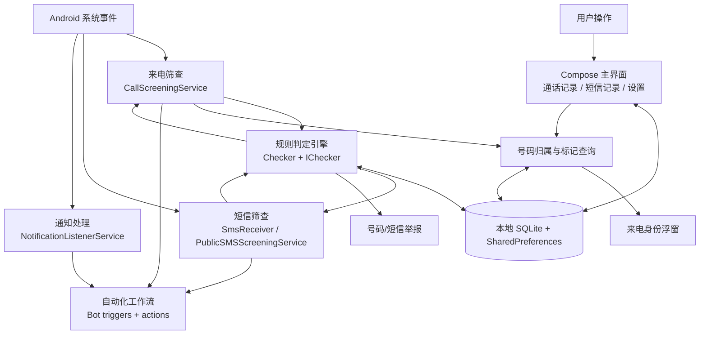
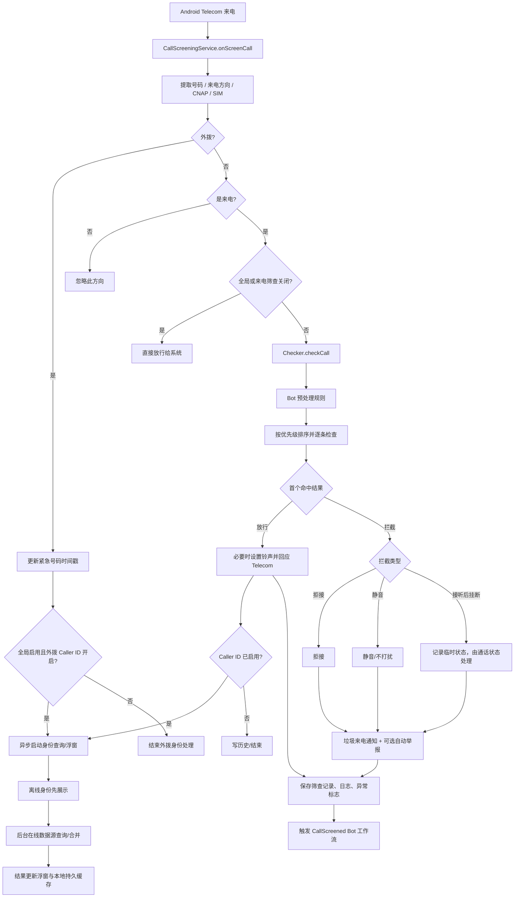
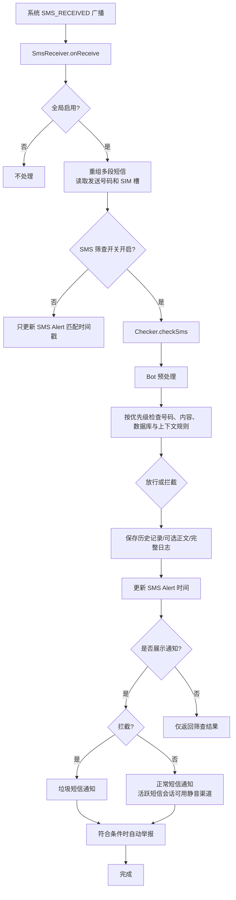
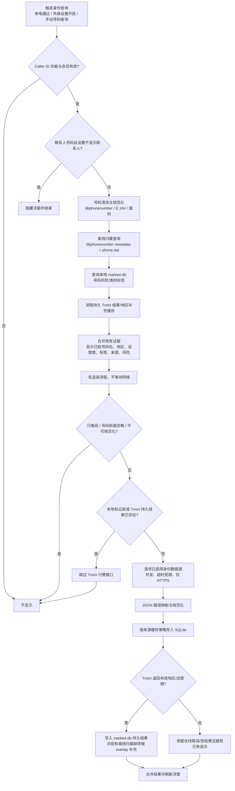
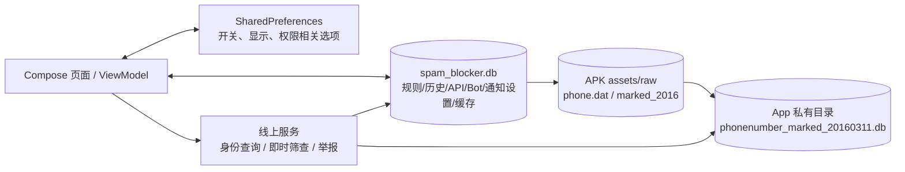

# SpamBlocker 功能模块与方框流程说明

> 本文依据当前工作区源码整理，目的是让 ChatGPT 能继续做架构分析、风险检查或绘制更细的流程图。源码是实现现状的主要依据；README 用于补充产品语义。文中不把历史计划当作已实现功能。项目是 Android 10+ 的来电与短信筛查应用。

## 1. 产品边界与顶层结构

SpamBlocker 不替换系统拨号器或短信客户端。它通过 Android Telecom、系统广播和用户授予的特殊权限执行号码筛查、通知、自动化与来电身份浮窗。

关键区分：

- `Checker` 的结果决定通话/短信是放行、拦截、静音或执行配置的拦截动作。
- 归属地、运营商、号码标记是身份信息展示能力；浮窗不会仅因为显示“推销/快递”等标签就自动拦截。是否拦截仍由筛查规则决定。
- 在线查询、上报和通知监听是可配置/需授权的外围能力；离线规则和本地数据库是独立路径。

## 2. 应用入口与用户可见模块

### 2.1 Android / 应用入口

| 入口 | 实现位置 | 职责 |
|---|---|---|
| Launcher / 主 Activity | `app/src/main/AndroidManifest.xml`, `ui/main/MainActivity.kt` | 初始化语言、主题、权限链、底部导航和历史 ViewModel；载入 Call、SMS、Settings 三个 tab。 |
| 来电筛查服务 | `service/CallScreeningService.kt` | Android Telecom 来电事件入口；获取号码、方向、CNAP、SIM 槽，调用筛查并及时回应系统。 |
| 短信广播接收器 | `service/SmsReceiver.kt` | 接收系统 `SMS_RECEIVED`；重组多段短信，筛查、落历史、发通知和可能上报。 |
| 公共短信筛查服务 | `service/PublicSMSScreeningService.kt` | 给兼容该协议的短信客户端提供按需筛查响应；是否可用取决于客户端是否支持该接口。 |
| 通知监听服务 | `service/NotificationListenerService.kt` | 捕获其它应用通知，供 Push Alert 规则/工作流使用；必须由用户在系统设置中授权。 |
| MMS / WAP Push 接收器 | `service/WapPushReceiver.kt` | 系统 WAP Push/MMS 广播入口。 |
| 通话状态接收器 | `service/CallStateReceiver.kt` | 观察通话状态，配合 Answer+Hang-up 拦截动作和来电浮窗生命周期。 |
| 快捷设置磁贴 | `service/Tile.kt`, `service/CustomTile.kt` | 从 Android Quick Settings 快速开关/进入相关功能。 |
| OAuth 回调 Activity | `ui/AuthCallbackActivity.kt` | 接收 `spamblocker://auth` 回调，供第三方服务授权流程使用。 |
| 通知跳转 Activity | `ui/NotificationTrampolineActivity.kt` | 通知点击入口，将用户带到应用、短信会话或执行通知动作。 |
| 崩溃报告页 | `ui/crash/CrashReportActivity.kt` | 展示/处理崩溃报告。 |

Manifest 中还声明了网络、通话、短信、联系人、日历、通知、悬浮窗、精确闹钟、使用情况访问等权限。它们并非全部启动必需；功能只有在相应权限、系统角色和设置满足时才可工作。

### 2.2 主界面三大入口

| Tab | 主要实现 | 功能入口 |
|---|---|---|
| 通话 | `ui/history/HistoryScreen.kt`, `HistoryViewModel.kt`, `HistoryCard.kt` | 查看已筛查来电、通过/拦截状态、原因、号码信息、筛查日志及历史操作。 |
| 短信 | 同一套 History Screen + SMS ViewModel | 查看收到并筛查的短信记录、结果、内容（受历史记录设置控制）、原因和通知相关操作。 |
| 设置 | `ui/setting/SettingScreen.kt` | 全局启停、来电浮窗、号码归属、筛查规则、正则、即时查询、举报 API、自动化、备份和其它设置。 |

历史列表的数据由 `HistoryViewModel` 从 Call/SMS 表装载；页面的通过/拦截显示选项影响记录过滤与未读数。具体显示短信内容受隐私/记录设置控制。

### 2.3 设置页模块入口

`SettingScreen.kt` 自上而下组织为以下组（部分组可折叠）：

1. **顶部规则测试**：运行测试前检查优先级冲突；有冲突时先弹出冲突提示。
2. **全局开关**：`GloballyEnabled`；同时有 Call/SMS 独立启用状态。
3. **来电显示**：Caller ID 浮窗、历史记录显示选项。
4. **中国号码信息**：离线归属、标记、在线数据源、诊断/测试、持久缓存统计和清除入口（由 `IdentitySettings` 实现）。
5. **快速筛查设置**：联系人、STIR、垃圾号码库、本地 AI、重复来电、已拨/已接号码、紧急情况、最近使用应用、免打扰时段、会议模式、拦截类型、通知。
6. **正则与提醒规则**：号码规则、短信内容规则、快捷复制规则、Push Alert、SMS Alert、SMS Bomb。
7. **即时查询 API**：用于实时筛查规则的 API 配置；不等同于 Caller ID 的身份数据源。
8. **号码举报 API**：人工/自动举报目标与配置。
9. **自动化（Bot）**：触发条件、动作和执行记录/状态。
10. **数据备份**：身份数据设置及通用备份/恢复。
11. **杂项**：语言、主题、FAQ、About、版本信息。

## 3. 来电筛查完整流程

入口为系统绑定的 `CallScreeningService.onScreenCall()`。实现会先创建来电身份会话 token，再异步处理，避免身份联网查询拖慢 Android Telecom 必须及时收到的筛查响应。

### 3.1 规则判定器

`service/checker/Checker.kt` 是来电和短信的统一筛查核心。它构造默认检查器 + 用户配置规则，执行 Bot 预处理，依据各检查器 `priority()` 由高到低遍历，取第一个非空结果。`PassedByDefault` 是最低优先级兜底，因此没有规则命中时默认放行。

内置检查信号主要包括：

- **安全/信任**：紧急号码、紧急事件放行窗口、联系人/非联系人、已接听号码、已拨号码。
- **风险号码**：STIR/SHAKEN、垃圾号码数据库、重复来电、在线即时查询、用户号码正则。
- **情境**：最近使用过的应用、会议模式、免打扰时段、短信/其它应用通知触发的临时白名单。
- **短信专属**：短信内容正则、本地朴素贝叶斯分类、短信轰炸检测。
- **号码属性规则**：号码、CNAP、地理位置、运营商、联系人组/联系人前缀、数据库前缀等规则检查器。

命中结果（`ICheckResult`）带有判定类型和理由，可进一步决定是否拦截、使用何种拦截方式、使用哪个通知渠道、是否自动举报以及历史记录中展示的筛查日志。

## 4. 短信筛查完整流程

注意：系统广播模式用于筛查已接收短信并由 SpamBlocker 接管相关通知；它不是完整短信客户端，不负责发送短信。另有 `PublicSMSScreeningService` 协议模式，由支持该协议的短信客户端实时询问结果。MMS 入口由 WAP Push receiver 处理。

## 5. 来电身份、归属地与号码标记流程

这条功能与规则筛查并行：来电筛查完成后，对通过的来电（以及配置允许的外拨号码）启动 Caller Identity Presenter。展示离线结果优先，在线查询在后台补齐，网络失败不会影响 Telecom 放行/拦截结果。

### 5.1 身份数据源和存储

- `CnNumberLookup` 负责离线规范化、国码识别和号码属性查询。使用 libphonenumber 元数据，并对中国大陆号码读取 APK 内置 `phone.dat` 七位号段数据；源码记录 libphonenumber metadata 版本 `9.0.39`、phone 数据版本标识 `phone.dat-2502`。
- `PhoneNumberMarkedDatabase` 将 APK 内 `marked_2016` 资源复制到应用私有数据库文件 `phonenumber_marked_20160311.db`。该开源快照用于历史号码打标（如骚扰、诈骗、推销、快递/送餐等）；它是静态旧数据，不应解释为实时或完整风险评级。
- 号码身份 API 与现有“即时查询/拦截 API”分开配置。身份 API 可配置 URL、method、headers、parameters、响应 JSON 路径、成功条件和缓存策略；`IdentitySettings` 提供数据源编辑、示例/预设、测试诊断和缓存管理入口。
- 一般身份证据缓存放在既有 `spam_blocker.db` 的 `cn_identity_cache`，按号码与来源指纹区分并遵循缓存 TTL；成功的 Tmini 标记/归属补充另写入上述 marked 数据库中的持久表。成功付费查询以持久结果优先，减少重复付费调用；失败缓存可以清理后重试。
- `cn_number_lookup_history` 保存手动查询的证据快照（最多保留最近 500 条）；`cn_number_marks` 保存用户自定义标签。
- `IdentityLookup` 的网络请求只接受 HTTPS、禁用自动重定向、限制响应体大小和连接/读取时限；并发来源上限为 6（引擎 semaphore 限制同时请求数），失败只形成来源证据，不应阻断通话流程。
- 当前实现注释明确：不默认上传通讯录号码；联系人号码即使显示身份浮窗，也跳过在线查询。

### 5.2 来电浮窗配置入口

`CallerID` 设置项负责申请悬浮窗与电话状态权限、启停浮窗和打开详细配置页。配置包括主题/背景、透明背景、字号、宽高、显示时长、联系人/外拨显示、来源提示、接听后保留、内容模板及预览。透明选项仅把背景色 Alpha 设为 0，不改变文字、尺寸或拖动能力。宽高设置与偏好保存在本机；高度输入限制最大 500dp。

## 6. API 即时查询、号码举报与自动化

### 即时查询 API

该组在设置页“即时查询”中配置，由 `Checker.InstantQuery` 在电话/短信筛查规则中使用。它的语义是返回一个筛查判定/风险命中，可以参与 allow/block 规则链；它不是单纯的号码归属地查询。多个 API 可并发执行并按来源配置映射与缓存。

### 举报 API

单独的“举报号码”配置用于用户手动或自动反馈号码。来电/短信命中可进入 `service/reporting/AutoReportSpam.kt` 的自动上报条件判断；上报状态、日志和失败信息可与历史记录关联。需要网络及目标服务配置。

### Automation / Bot

Bot 由数据库保存 trigger 与 action 列表。触发入口散布在筛查前、筛查后、日程、通知或快捷磁贴等事件处理点；`service/bot/Triggers.kt` 描述触发器，`Actions1..4.kt` 定义动作，`MyWorkManager.kt`、`Schedule.kt` 处理工作调度。动作范围包括通过/拦截前置处理、铃声/通知/复制等应用行为，以及按配置执行的系统或日历相关操作。具体触发器和动作以 Bot 编辑器可选项及对应实现为准。

## 7. 数据层与设置持久化

主要本地表（完整 schema 以 `db/Db.kt` 为准）：

- 号码/短信内容/快捷复制正则规则。
- Call/SMS 历史记录及筛查日志、垃圾号码、联系人/号码规则相关数据。
- Notification channels、Bot/动作、查询 API 与举报 API 配置、朴素贝叶斯训练数据。
- CN 扩展表：`cn_identity_cache`、`cn_number_lookup_history`、`cn_number_marks`。
- 打标数据库副本：原始开源号码标签表，以及应用扩展的 `tmini_mark_cache`、`tmini_region_overlay`。

安装包更新通常保留应用私有数据；卸载或 Android 清除应用数据会删除私有 SQLite/偏好。`allowBackup` 和 backup rules 已配置，但实际是否恢复取决于系统/备份传输及用户操作，不能把 APK 重新安装等同于必然恢复设置。

## 8. 权限与外部依赖边界

| 能力 | 相关权限/系统授权 | 不具备时的主要影响 |
|---|---|---|
| 通话筛查 | 用户将 SpamBlocker 设为系统来电筛查应用；电话状态权限用于部分状态/浮窗生命周期 | Telecom 不会把筛查事件交给应用，或状态相关动作不可用。 |
| 短信广播筛查 | READ/RECEIVE SMS 等运行时授权 | 无法读取/筛查对应短信广播。 |
| 短信筛查协议 | 兼容客户端主动绑定公共筛查服务 | 不支持协议的短信客户端不会走该路径。 |
| Caller ID 浮窗 | `SYSTEM_ALERT_WINDOW` 特殊访问 + 电话状态权限 | 无法显示或不能准确在通话状态变化时关闭。 |
| Push Alert | Notification Listener 特殊访问 | 无法读取其它应用通知并据此触发例外规则。 |
| 联系人规则 | READ_CONTACTS | 联系人匹配/号码保护规则降级。 |
| 最近使用应用 | PACKAGE_USAGE_STATS 特殊访问 | Recent Apps 条件无法可靠判断。 |
| 网络身份/即时查询/举报 | INTERNET + 可用网络/API Key/服务端可达 | 离线功能仍可用，在线证据会超时或失败。 |
| 日历自动化 | READ_CALENDAR | 基于日历事件的自动调节不可用。 |
| 自动短信回复 | SEND_SMS | 对被拦截号码执行回复动作不可用。 |

外网请求受设备网络/VPN/DNS/代理、防火墙和服务端 TLS 影响；浏览器能访问并不自动证明 Android App 所在网络栈也能访问。接口配置的成功测试也不等于线上来电的端到端验收。

## 9. 主要源码导航

| 子系统 | 入口/核心文件 |
|---|---|
| Android 声明、权限和服务注册 | `app/src/main/AndroidManifest.xml` |
| 主导航与生命周期 | `app/src/main/java/spam/blocker/ui/main/MainActivity.kt`, `App.kt`, `GlobalVariables.kt` |
| 来电筛查 | `service/CallScreeningService.kt`, `service/CallStateReceiver.kt` |
| 短信/MMS | `service/SmsReceiver.kt`, `service/PublicSMSScreeningService.kt`, `service/WapPushReceiver.kt` |
| 判定与结果类型 | `service/checker/Checker.kt`, `service/checker/CheckResult.kt` |
| 历史列表 | `ui/history/HistoryScreen.kt`, `HistoryViewModel.kt`, `HistoryCard.kt` |
| 设置页 | `ui/setting/SettingScreen.kt` 及其 `quick/`, `regex/`, `api/`, `bot/`, `misc/` 子目录 |
| 归属地/标签模型和合并 | `util/CnNumberLookup.kt`, `util/NumberIdentity.kt`, `util/IdentityLookup.kt` |
| 来电身份呈现与会话 | `service/CallerIdentityPresenter.kt`, `util/CallerIdentitySession.kt` |
| 浮窗与样式 | `ui/setting/quick/CallerID.kt`, `ui/widgets/FloatingWindow.kt`, `util/CallerIdAppearance.kt` |
| SQLite | `db/Db.kt`, `db/NumberIdentityCache.kt`, `db/CnNumberHistory.kt`, `util/PhoneNumberMarkedDatabase.kt` |
| 机器人/调度 | `service/bot/Triggers.kt`, `Actions1.kt`–`Actions4.kt`, `MyWorkManager.kt`, `Schedule.kt` |
| 自动举报 | `service/reporting/AutoReportSpam.kt` |
| API 配置 UI | `ui/setting/api/IdentitySettings.kt`, `ApiList.kt`, `ApiSetupDialog.kt`, `ApiPresets.kt` |

## 10. 可直接交给 ChatGPT 的分析任务

> 请基于这份模块图，并逐一检查表中源码，不要仅依据文档推断实现。先列出当前项目真实的入口与核心数据流，再重点分析：
> 1. 来电筛查及时响应 Telecom 与后台 Caller ID 网络查询之间的并发/生命周期边界；
> 2. `Checker` 优先级、兜底放行与不同拦截方式是否存在规则遮蔽或异常路径；
> 3. 短信广播模式、公共短信筛查协议和通知接管模式的边界及潜在重复通知；
> 4. 身份 API、本地缓存、Tmini 持久化、`marked.db` 地区 overlay 与 `phone.dat` 的覆盖优先级，验证是否能避免覆盖原始数据/重复付费；
> 5. 运行时权限缺失、网络失败、应用被系统杀死、配置恢复/卸载重装时的降级表现；
> 6. 给出按严重度排序的问题清单，并为每项附源码文件/函数、复现条件、建议验证方法。把已证实事实和推测分开。
